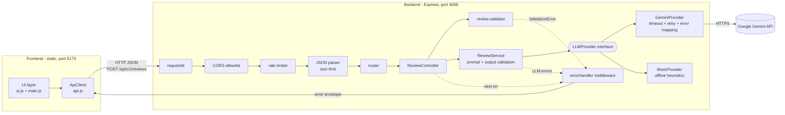
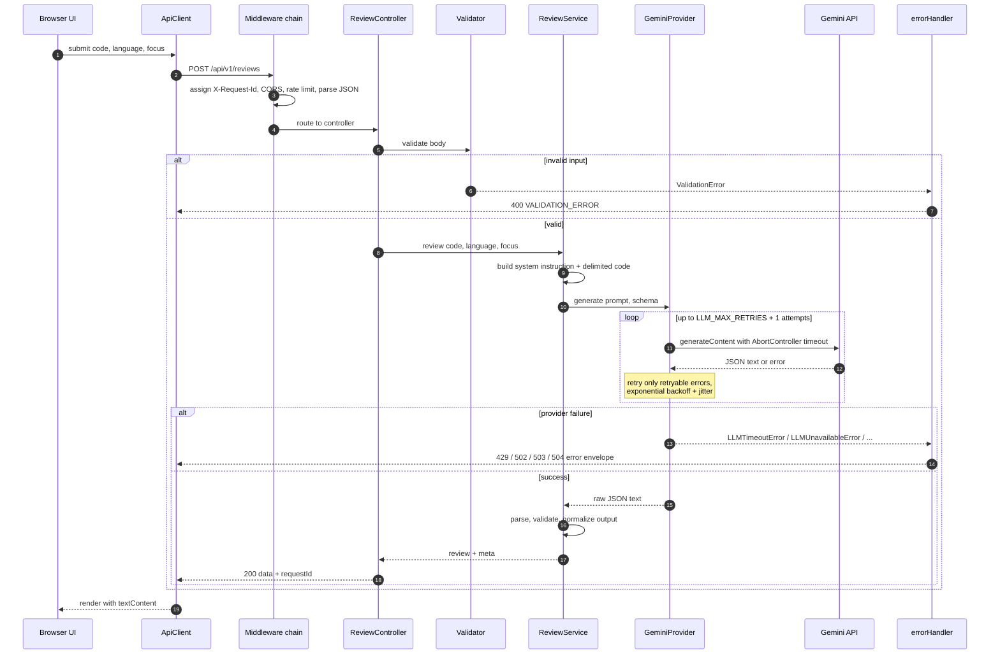

# AI Code Review Assistant

A small AI-powered web app: paste a code snippet, pick a language, and get a structured review (summary, score, issues with severity/line/suggestion, strengths) produced by an LLM (Google Gemini).

Built as the **Scaler AI-First Backend Capstone** project. The requirement was a frontend, a backend that calls an LLM API, basic error handling, and a clear separation between UI and API. This repo keeps those pieces apart, and the backend runs without an API key in `mock` mode.

> Design rationale, patterns, trade-offs and interview Q&A: see [docs/DESIGN.md](docs/DESIGN.md).

---

## Features

- **Structured AI review**: summary, overall score from 1 to 10, issues (`severity`, `category`, `line`, `title`, `description`, `suggestion`) and strengths.
- **Focus areas**: optionally limit the review to `bugs`, `security`, `performance`, `readability` or `best-practice`.
- **Versioned REST API**: `/api/v1/...` with a consistent success and error envelope, plus a `requestId` on every response.
- **Resilient LLM calls**: a timeout on each attempt, retries with exponential backoff and jitter (only for retryable failures), and mapping of provider errors to stable API error codes.
- **Never trusts LLM output**: JSON mode with a response schema, then server-side validation and normalization.
- **Pluggable providers**: `GeminiProvider` for real use, `MockProvider` (an offline heuristic reviewer) for demos, tests and CI.
- **Basic hardening**: CORS allowlist, rate limiting, input size limits, and an API key that stays on the server.
- **Observability basics**: JSON-line logs that carry the request id, latency and provider.
- **Zero-build frontend**: vanilla HTML/CSS/ES modules. All results are rendered with `textContent` to prevent XSS.

## Tech stack

| Layer    | Choice                                                                 |
| -------- | ---------------------------------------------------------------------- |
| Runtime  | Node.js >= 20 (CommonJS)                                               |
| Backend  | Express 5, `cors`, `express-rate-limit`, `dotenv`                      |
| LLM      | Google Gemini via the official `@google/genai` SDK (`gemini-2.5-flash`) |
| Frontend | Vanilla HTML + CSS + ES modules, zero-dependency static server         |
| Tests    | Built-in `node:test` + `node:assert` (no test framework dependency)    |

## Architecture



**Separation of concerns:** the browser knows only the REST contract. `api.js` is the only frontend module that talks to the backend, and the Gemini SDK appears only in `GeminiProvider.js`. Controllers are thin, business logic lives in `ReviewService`, and vendor details stay behind the `LLMProvider` interface.

### Request lifecycle



## Folder structure

```
.
├── backend/
│   ├── src/
│   │   ├── server.js                  # bootstrap, graceful shutdown
│   │   ├── app.js                     # createApp({ config, llmProvider }) factory
│   │   ├── config/index.js            # loadConfig, fail-fast validation of env
│   │   ├── routes/
│   │   │   ├── review.routes.js
│   │   │   └── health.routes.js
│   │   ├── controllers/review.controller.js
│   │   ├── services/review.service.js # builds prompt, calls provider, validates/normalizes output
│   │   ├── validators/review.validator.js
│   │   ├── prompts/review.prompt.js   # system prompt + response JSON schema
│   │   ├── llm/
│   │   │   ├── LLMProvider.js         # abstract interface
│   │   │   ├── GeminiProvider.js      # @google/genai SDK, timeout, retry, error mapping
│   │   │   ├── MockProvider.js        # offline heuristic reviewer
│   │   │   └── index.js               # createLLMProvider factory
│   │   ├── middleware/
│   │   │   ├── requestId.js
│   │   │   ├── errorHandler.js
│   │   │   ├── notFound.js
│   │   │   └── rateLimiter.js
│   │   ├── errors/AppError.js         # AppError hierarchy
│   │   └── utils/
│   │       ├── logger.js              # JSON-line logs
│   │       └── retry.js               # backoff + jitter
│   ├── tests/                         # node:test unit + HTTP integration tests
│   ├── .env.example
│   └── package.json
├── frontend/
│   ├── index.html
│   ├── styles.css
│   ├── js/
│   │   ├── config.js                  # API base URL
│   │   ├── api.js                     # the ONLY module that calls the backend
│   │   ├── ui.js                      # DOM rendering (textContent only)
│   │   └── main.js                    # wiring / event handlers
│   ├── server.js                      # zero-dependency static server
│   └── package.json
└── docs/
    └── DESIGN.md                      # low-level design write-up
```

## Quick start

**Prerequisites:** Node.js **>= 20**. You can get a Gemini API key from [Google AI Studio](https://aistudio.google.com/apikey). Mock mode does not need one.

```bash
# 1. Backend
cd backend
cp .env.example .env        # then set GEMINI_API_KEY=... in .env
npm install
npm start                   # -> http://localhost:4000

# 2. Frontend (in a second terminal)
cd frontend
npm start                   # -> http://localhost:5173
```

Open **http://localhost:5173**, paste some code and click review.

**Mock mode (no API key):** set `LLM_PROVIDER=mock` in `backend/.env`, or run it inline:

```bash
cd backend
LLM_PROVIDER=mock npm start
```

**Tests:**

```bash
cd backend
npm test
```

## Configuration

All configuration comes from environment variables (`backend/.env`). `loadConfig()` validates them at startup and **fails fast** on invalid values. For example, it refuses to start when `LLM_PROVIDER=gemini` and `GEMINI_API_KEY` is missing.

| Variable               | Default                 | Description                                                    |
| ---------------------- | ----------------------- | -------------------------------------------------------------- |
| `PORT`                 | `4000`                  | HTTP port of the API                                           |
| `NODE_ENV`             | `development`           | `development`, `production` or `test`                          |
| `CORS_ORIGINS`         | `http://localhost:5173` | Comma-separated allowlist of browser origins                   |
| `LLM_PROVIDER`         | `gemini`                | `gemini` or `mock`                                             |
| `GEMINI_API_KEY`       | none                    | Required when `LLM_PROVIDER=gemini`. Never sent to the browser |
| `GEMINI_MODEL`         | `gemini-2.5-flash`      | Gemini model id                                                |
| `LLM_TIMEOUT_MS`       | `30000`                 | Timeout for **each attempt** of an LLM call                    |
| `LLM_MAX_RETRIES`      | `2`                     | Extra attempts for retryable LLM failures                      |
| `MAX_CODE_CHARS`       | `20000`                 | Maximum length of the `code` field                             |
| `RATE_LIMIT_WINDOW_MS` | `60000`                 | Rate-limit window                                              |
| `RATE_LIMIT_MAX`       | `20`                    | Maximum requests per IP per window                             |

## API reference

Base URL: `http://localhost:4000`. Every response includes an `X-Request-Id` header. JSON bodies also carry it as `requestId`.

### `GET /api/health`

```bash
curl http://localhost:4000/api/health
```

```json
{ "status": "ok", "provider": "gemini:gemini-2.5-flash", "uptimeSec": 12 }
```

### `GET /api/v1/languages`

```bash
curl http://localhost:4000/api/v1/languages
```

```json
{
  "data": ["javascript", "typescript", "python", "java", "go", "c", "cpp", "csharp",
           "ruby", "php", "rust", "kotlin", "swift", "sql", "other"]
}
```

### `POST /api/v1/reviews`

**Request body**

| Field      | Type     | Required | Rules                                                                       |
| ---------- | -------- | -------- | --------------------------------------------------------------------------- |
| `code`     | string   | yes      | 1 to `MAX_CODE_CHARS` (20000) characters, not only whitespace              |
| `language` | string   | yes      | One of `/api/v1/languages`                                                  |
| `focus`    | string[] | no       | Subset of `bugs`, `security`, `performance`, `readability`, `best-practice` |

```bash
curl -X POST http://localhost:4000/api/v1/reviews \
  -H "Content-Type: application/json" \
  -d '{
        "code": "function add(a, b) { return a - b }\nconsole.log(eval(userInput))",
        "language": "javascript",
        "focus": ["bugs", "security"]
      }'
```

**200 OK**

```json
{
  "data": {
    "review": {
      "summary": "The function name contradicts its implementation, and eval on user input is a critical security risk.",
      "overallScore": 3,
      "issues": [
        {
          "severity": "critical",
          "category": "security",
          "line": 2,
          "title": "eval on untrusted input",
          "description": "eval executes arbitrary code supplied by the user.",
          "suggestion": "Remove eval; parse the input explicitly (e.g. JSON.parse) and validate it."
        },
        {
          "severity": "major",
          "category": "bug",
          "line": 1,
          "title": "add() subtracts",
          "description": "The function returns a - b instead of a + b.",
          "suggestion": "Return a + b."
        }
      ],
      "strengths": ["Small, single-purpose function"]
    },
    "meta": {
      "provider": "gemini:gemini-2.5-flash",
      "language": "javascript",
      "latencyMs": 2140,
      "reviewedAt": "2026-11-02T10:15:30.000Z"
    }
  },
  "requestId": "6f1c2b0e-3d0a-4a59-9a57-2f5b8c1d9e44"
}
```

`severity` is one of `critical | major | minor | info`. `category` is one of `bug | security | performance | readability | best-practice`. `line` is optional (a positive integer) and is omitted when the issue is not tied to a specific line.

**Error example (400)**

```bash
curl -X POST http://localhost:4000/api/v1/reviews \
  -H "Content-Type: application/json" \
  -d '{"code": "", "language": "cobol"}'
```

```json
{
  "error": {
    "code": "VALIDATION_ERROR",
    "message": "Invalid review request.",
    "details": [
      { "field": "code", "message": "code is required and must be a non-empty string." },
      { "field": "language", "message": "language must be one of: javascript, typescript, ..." }
    ],
    "retryable": false
  },
  "requestId": "0b9f6f7e-1a52-4c55-8c5e-5d1a7f0c2b11"
}
```

## Error handling

Every error, whether expected or not, passes through one `errorHandler` middleware and comes back in the same envelope:

```json
{ "error": { "code": "...", "message": "...", "details": [], "retryable": false }, "requestId": "..." }
```

| Code                | HTTP | Retryable | When                                                                                             |
| ------------------- | ---- | --------- | ------------------------------------------------------------------------------------------------ |
| `VALIDATION_ERROR`  | 400  | no        | Body fails validation. `details` holds `[{ field, message }]`                                    |
| `INVALID_JSON`      | 400  | no        | Request body is not valid JSON                                                                   |
| `NOT_FOUND`         | 404  | no        | Unknown route                                                                                    |
| `PAYLOAD_TOO_LARGE` | 413  | no        | Body exceeds the JSON parser size limit                                                          |
| `RATE_LIMITED`      | 429  | yes       | Our own per-IP rate limiter was hit                                                              |
| `LLM_RATE_LIMITED`  | 429  | yes       | Gemini quota or rate limit (after server-side retries)                                           |
| `LLM_BAD_RESPONSE`  | 502  | no        | Response blocked by safety filters, truncated, malformed JSON, or output that failed schema validation |
| `LLM_UNAVAILABLE`   | 503  | yes / no  | Gemini 5xx or network error is retryable. An invalid API key (401/403) is **not** retryable, and its message hides the details |
| `LLM_TIMEOUT`       | 504  | yes       | An attempt exceeded `LLM_TIMEOUT_MS` (after retries)                                             |
| `INTERNAL_ERROR`    | 500  | no        | Any unexpected error. The message is generic and the stack trace goes only to the server logs    |

Retryable LLM failures are retried **on the server** up to `LLM_MAX_RETRIES` times with exponential backoff and jitter. The client sees the error only once those retries are used up, and the `retryable` flag tells the UI whether to offer a "Try again" button.

## Testing

The tests use the built-in `node:test` runner, so there is no test framework dependency. They run fully offline.

```bash
cd backend && npm test
```

- **Unit tests**
  - `review.validator`: required fields, length limit, language allowlist, focus subset, multiple errors gathered into `details`.
  - `ReviewService`: prompt assembly, parsing and normalization of model output, rejection of malformed or out-of-schema output (`LLM_BAD_RESPONSE`).
  - `retry`: retries only retryable errors, respects the maximum attempt count, backoff grows between attempts.
  - `GeminiProvider` error mapping: uses a **fake SDK client** to simulate 429, 5xx, 401/403, timeouts, blocked or truncated responses, and checks the resulting `AppError` subclasses.
- **Integration tests**: the real Express app, built with `createApp({ config, llmProvider: new MockProvider() })` and exercised over HTTP. They cover the happy path, the error envelope and status codes, the 404 route, invalid JSON, and the `X-Request-Id` header.

Because `createApp` takes its dependencies as arguments, tests need no module mocking and no network access.

## Future improvements

- **Persistence and review history** in a database (e.g. PostgreSQL), with `GET /api/v1/reviews/:id`.
- **Authentication and per-user quotas** using API keys or OAuth, with usage metering.
- **Streaming responses** over Server-Sent Events, so the UI can show progress on long reviews.
- **Caching identical reviews** keyed by a hash of `code + language + focus + model + prompt version`.
- **A job queue for large files and repositories**, which would make the API asynchronous (`202 Accepted` plus polling or a webhook).
- **Observability** with OpenTelemetry traces and metrics (LLM latency, token usage, error rate by code).
- **Multi-provider fallback**: if Gemini is unavailable, fall back to a second `LLMProvider` behind a circuit breaker.

## License

[MIT](LICENSE) © 2026 Anand Shangarpawar
